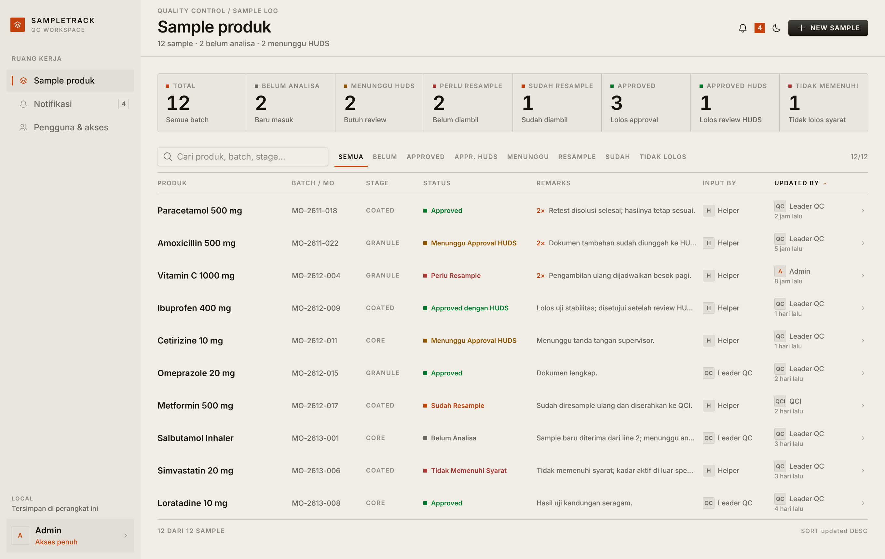
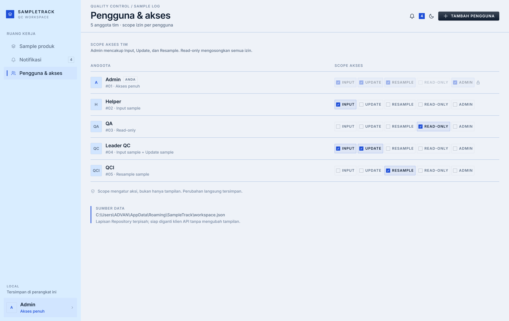

# SampleTrack

An approval workspace for product samples, built with Rune's native UI. The list is the
product: each row shows the sample's product, batch/MO, stage, approval status, remarks, who
input it, and who last updated it. The two audit columns are filled from the signed-in person
and cannot be typed by hand. New samples start at **Belum Analisa**; once a status decision is
saved the sample is final and nobody can edit it again. Remarks work like a cell's comments in a
spreadsheet: every sample keeps a thread, many people can add to it while the sample is open,
and the list shows the latest one with a count.




**Live demo:** <https://crauxzahard.github.io/sampletrack-demo/> — open it in Chrome or Edge
with WebGPU. It is the same web build described under [Web](#web), hosted on GitHub Pages.

## Design

The direction comes from the ui-ux-pro-max skill: **Swiss Modernism 2.0** for the layout and a
**data-dense dashboard** for the table. Warm paper, graphite ink and a safety-orange accent; 1–3
point corners; uppercase micro-labels; square monograms; flat ledger rows separated by hairlines.
There are no floating card stacks, pastel icon tiles, gradients or pill badges. Light and dark
modes share the same structure.

## Run

```sh
cargo run -p sample-tracker
```

The app opens signed in as Admin. Click the person card at the bottom of the sidebar to switch
accounts; the switch simulates a login in this local-first build. Ctrl/Cmd+N opens the
new-sample dialog when your scope allows it.

The demo team uses the real scopes, including a person who holds two at once:

| Person | Scopes |
| --- | --- |
| Helper | Input sample |
| QA | Read-only |
| Leader QC | Input sample + Update sample |
| QCI | Read-only |
| Admin | Admin (all scopes) |

Snapshot scenes render deterministically without a window:

```sh
cargo run -p sample-tracker -- --snap sample-list.png --scene samples --theme dark --size 1360x860
cargo run -p sample-tracker -- --snap update.png --scene edit-sample --theme light --size 1360x860
```

Scenes: `samples`, `people`, `notices`, `new-sample`, `new-user`, `edit-sample`, `switcher`,
`readonly`, `readonly-edit`, `input-edit`, `leader-edit`, `toast`.

## Scopes

Permissions are enforced in the actions as well as hidden in the UI.

| Scope | Add sample | Update status | Add remarks | Bulk notify | Manage team |
| --- | --- | --- | --- | --- | --- |
| Read-only | — | — | — | — | — |
| Input Sample | ✓ | — | ✓ | — | — |
| Update Sample | — | ✓ | ✓ | ✓ | — |
| Admin | ✓ | ✓ | ✓ | ✓ | ✓ |

Input and Update combine: Leader QC holds both, so one person can enter a sample and then move
its status. Read-only is the empty set; Admin covers every scope.

An admin changes any member's scope on **Pengguna & akses**. The last admin cannot be demoted.
An update is saved with the current person in **Updated by** and the new status; the picked
recipients get one in-app notification. Notifications can only be sent from that first status
update, never from a finished sample or from anywhere else in the app. The notification page
shows each person only the messages addressed to them, with per-person read state, and filters
for **Semua**, **Belum dibaca**, **Belum analisa**, **Approved**, **Menunggu HUDS**, and
**Resampling** so a reader such as QCI can open the resampling queue directly.

Remarks are separate from the status save: the composer appends immediately and keeps the
author. A decision closes the sample: no further status changes and no further remarks.

Statuses: **Belum Analisa** (initial), **Approved**, **Menunggu Approval HUDS**, **Resampling
Ulang**. Stages: **Granule**, **Core**, **Coated**.

## Data

`store::Repository` is the only persistence boundary:

- `LocalJson` on the desktop writes one JSON document to the user's application data folder
  (`%APPDATA%\SampleTrack\workspace.json` on Windows).
- In the browser it uses `localStorage`.
- Tests use `Memory`.

Swapping it for a REST client means implementing the same three methods; the views and the
actions never touch a file or a socket.

First launch seeds five people and twelve samples across the four statuses. A committed change
writes through the repository immediately. The demo is local to one machine; multi-user sync
needs the server-backed implementation. The workspace schema is versioned: a saved workspace
older than v2 is ignored and reseeded, so the current demo people, stages and statuses appear.

## Scale

The table is built for large workspaces, not just the demo:

- `virtual_rows` mounts only the rows in the viewport (plus a small buffer). A million-row result
  still builds roughly ten rows per frame.
- The filtered/sorted row index is cached and rebuilt only when the query, filter, sort or sample
  data changes, not on every frame.
- Counting runs in one pass and is cached separately; adding a remark does not rescan the table.
- Search and text sorting compare case-insensitively without allocating lowercase copies per
  sample or per comparison.
- The page itself does not scroll: metrics, toolbar, header and footer stay fixed while the log
  body scrolls.

The ignored stress test seeds **1,000,000 samples** and measures the query path:

```sh
cargo test -p sample-tracker stress_one_million -- --ignored --nocapture --release
```

Release-profile measurements on the development machine:

| Operation | Time |
| --- | --- |
| Count 1,000,000 rows | 4.7 ms |
| Build index + default sort | 98 ms |
| 1,000 cached `visible_len` calls | 6.9 µs total |
| Sort by product | 598 ms |
| Search `MO-0500` | 48 ms |
| 120 mounted-row lookups | 23 µs total |

The frame path is flat either way: once the index is cached, a frame only reads the mounted
window. The first query after data or a filter changes pays the scan and sort once; it is not
repeated per frame. Sorting by a text column on a million rows is the slow path (about 0.6 s
here), which is why the production recommendation is a server-side indexed sort with cursor
pagination.

For a real multi-user service, keep data on the server: paginate with a cursor, filter and sort
in SQL with indexes on `status`, `stage`, `batch` and `updated_at`, keep a separate search index
for remarks, and return aggregate counts from a materialised counter. Loading a million rows
into the browser's `localStorage` is not the deployment shape; the local store is the demo
boundary, not the production database.

## Layout

| File | Holds |
| --- | --- |
| `src/model.rs` | scopes, statuses, samples, remarks, notices, seed workspace, JSON shapes |
| `src/store.rs` | the `Repository` trait and its local/web/test implementations |
| `src/app.rs` | state, permission checks, commits, filtering/sorting, snapshot scenes |
| `src/ui/` | sidebar and header, sample table, team page, inbox, dialogs, shared widgets |
| `src/theme.rs` | warm paper, graphite and safety-orange tokens over rune-kit |

## Web

Rune's experimental web target renders the same views through WebGPU. Run the build script from a Rune checkout with this package in examples/sample-tracker; this repo is the app source, not a copy of the framework:

```sh
rustup target add wasm32-unknown-unknown
cargo install wasm-bindgen-cli --version 0.2.129 --locked
scripts/web-build.sh sample-tracker --out target/web-sample-tracker
python3 -m http.server 8000 -d target/web-sample-tracker
```

Then open <http://localhost:8000>. A production host must serve the folder over HTTPS and serve
`.wasm` as `application/wasm`; no special headers are needed.

The bundled build in this workspace is `target/web-sample-tracker/`. If a fresh build does not
copy Rune's full Inter faces beside the page, add them:

```sh
cp crates/rune/assets/web/Inter-*.ttf target/web-sample-tracker/
```

## Tests

```sh
cargo test -p sample-tracker
```

The tests cover scope enforcement (including a person with both Input and Update), automatic
audit attribution, the last-admin guard, the remark thread, per-person notification
delivery/read state, and a headless row → dialog → save interaction.
